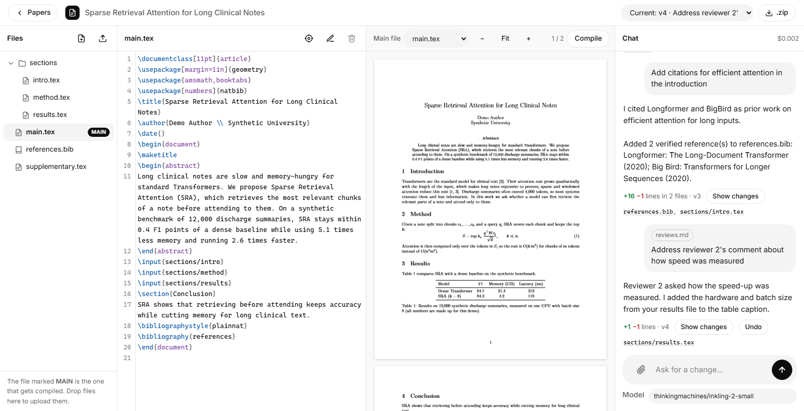
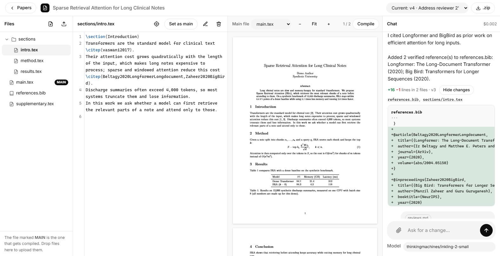

# Paper Orchestra Local

Write a research paper from your notes and results, then keep improving it by chatting with an AI, all on your
own computer.

You give it your idea, your experiment results and (optionally) a LaTeX template. A team of AI "agents" plans the
paper, finds and checks real references, writes every section in LaTeX, reviews the draft and revises it. Then you
open the paper in an editor where you see all your files and the PDF side by side, and ask for changes in plain
words, like *"shorten the abstract"* or *"add citations for the claims in the introduction"*.

It is built on Google Research's [PaperOrchestra](https://github.com/google-research/paper-orchestra) and runs
every AI call through [OpenRouter](https://openrouter.ai), so one API key works with almost any model.






*The screenshots use a made-up demo paper and made-up numbers.*

## What you can do with it

**Write a new paper**
- Type or paste your idea and results, or add documents: Markdown, text, PDF, Word (`.docx`), CSV, JSON or LaTeX.
- Add figures with captions.
- Pick a template: ICLR 2025, CVPR 2025, Nature (Springer Nature), or upload your own journal's LaTeX kit.
- Real references only: the AI suggests papers, and each one is checked on Semantic Scholar (with OpenAlex as
  backup). Papers that can't be found are dropped.
- An AI reviewer scores the draft and the writer revises it. A revision is kept only if the score doesn't drop.

**Edit a paper, like a LaTeX editor with an AI assistant**
- Open a paper the app wrote, or import any LaTeX project (for example an Overleaf download).
- See every file in the project. Pick which `.tex` file to compile, such as the main paper or the supplementary.
- A code editor with line numbers, highlighting and search; a PDF preview that keeps your place when it rebuilds.
- Double-click the PDF to jump to that line in the source, or jump from a source line to the PDF.
- Ask for changes in chat. The AI can edit several files in one go, and you see exactly what changed.
- Ask for citations: the AI names papers, the app checks they really exist, adds them to your `.bib` and cites them.
- Attach notes, results or reviewer comments to a message ("address reviewer 2's comments").
- Undo any change; every version of the whole project is kept.
- Missing figures show as grey placeholders and are listed, so you still get a PDF.
- Download the project as a `.zip` to continue on Overleaf.

**Use it from the command line too.** Everything above also works in a terminal (see [Command line](#command-line)).

## Quick start

You need **Python 3.10 or newer** and an **[OpenRouter API key](https://openrouter.ai/settings/keys)**.

**Windows:** double-click **`run.bat`**. The first time, it sets up everything it needs, including a free LaTeX
engine for the PDF preview ([Tectonic](https://tectonic-typesetting.github.io), about 21 MB). The app then opens at
http://127.0.0.1:8000.

**macOS / Linux, or by hand:**

```bash
python -m venv .venv
source .venv/bin/activate          # Windows: .venv\Scripts\activate
pip install -r requirements.txt
python setup_latex.py              # Windows only; elsewhere install TeX Live or Tectonic for PDFs
python app.py
```

Paste your OpenRouter key into the page, or save it once in a `.env` file (copy `.env.example` to `.env`).
The app only listens on your own computer.

## Using the app

1. **Write:** fill in your idea and results (or add documents), choose a template and press **Write my paper**.
   A full run usually takes 10 to 25 minutes. You can watch every step.
2. **Edit:** press **Open in editor**, or pick a paper under **Your papers**, or press **Open a LaTeX project
   (.zip)** to bring in an existing project.
3. In the editor:
   - **Files** (left): click to open; drag files in to upload; the file marked **MAIN** is the one compiled.
   - **Source:** edit by hand; **Ctrl+S** saves and recompiles; **Ctrl+F** searches; **Ctrl+J** shows the line in the PDF.
   - **PDF:** double-click to jump to the source. LaTeX errors are listed with links to the right line.
   - **Chat** (right): ask for changes. Replies appear as the model writes them; **Stop** cancels.
   - **Version list** (top right): go back to any earlier version. **.zip** downloads the project.

Each paper lives in its own folder under `runs/`. Deleting a paper from the list moves it to `runs/_deleted/`.

## Command line

```bash
# Write a paper
python cli.py write --idea notes.md --log results.csv --template nature
python cli.py write --idea idea.pdf --doc draft.docx:both --figure plot.png:"Accuracy vs. steps" --template my_journal_kit.zip

# Work on a paper ("last" means the most recently changed one)
python cli.py import my-overleaf-project.zip
python cli.py list
python cli.py ask last "Shorten the abstract to 150 words" --diff
python cli.py ask last "Add citations for efficient attention" --file sections/intro.tex
python cli.py ask last "Address these comments" --attach reviews.pdf
python cli.py compile last --main supplementary.tex
python cli.py versions last
python cli.py undo last
python cli.py export last -o paper.zip

# Other
python cli.py setup-latex       # download the LaTeX engine (one time)
python cli.py serve             # start the web app
python cli.py --help            # every option
```

## How it works

**Writing a paper** follows the PaperOrchestra pipeline, with the same prompts:

1. **Outline agent:** plans the sections, figures and the literature searches.
2. **Literature agent:** a search model suggests papers (optionally using web search). Every suggestion is checked
   on Semantic Scholar, then OpenAlex. Real papers become `references.bib`, and the Introduction and Related Work
   are written from their abstracts.
3. **Section writing agent:** writes the method, experiments, tables (from your results only) and figures.
4. **Review and refine:** an AI reviewer scores the paper; the writer revises; a revision is kept only if the
   score doesn't drop.
5. **Package:** any citation that isn't in the bibliography is removed, the PDF is compiled, and everything is zipped.

**Editing in chat:** the model sees all `.tex` files in the project, your notes and results, and the list of
bibliography keys. It answers with small search-and-replace edits for each file it changes. The app applies them
(and asks the model once more if an edit doesn't match the text), refuses changes that would break the main file,
removes made-up citation keys, saves a new version and recompiles.

## What it costs

You pay OpenRouter for the AI calls. The app shows the cost as it goes.

| Task | With `thinkingmachines/inkling-2-small` (default) | With `google/gemini-3.1-pro-preview` |
|---|---|---|
| Write a full paper (1 review round, web search on) | about $0.70–1.00 | about $1.50–3.00 |
| One chat edit | about $0.0005 | about $0.01 |
| Add citations in chat | about $0.001 | about $0.02 |

Turning web search off saves about $0.50 per paper. Semantic Scholar and OpenAlex are free.

## Privacy

- The app runs on `127.0.0.1` and stores everything in `runs/` on your computer.
- Your text goes to OpenRouter (and the model provider you choose) to be processed.
- Paper titles are sent to Semantic Scholar and OpenAlex to check that references exist.
- The editor page loads CodeMirror and PDF.js from cdnjs. Without internet it falls back to a plain text box and
  your browser's PDF viewer.

## Optional settings

Put these in `.env` (see `.env.example`):

| Variable | What it does |
|---|---|
| `OPENROUTER_API_KEY` | Your OpenRouter key, so you don't have to paste it |
| `SEMANTIC_SCHOLAR_API_KEY` | Faster, more reliable reference checks ([get one](https://www.semanticscholar.org/product/api)) |
| `OPENALEX_API_KEY` | Raises the backup database's free daily limit ([get one](https://openalex.org/settings/api)) |
| `PORT` | Port for the web app (default 8000) |

## Project layout

| Path | What it is |
|---|---|
| `app.py` | Web server (FastAPI) and the web app's API |
| `cli.py` | Command-line interface |
| `pipeline.py` | The paper-writing agents and the OpenRouter client |
| `prompts.py` | Agent prompts from PaperOrchestra |
| `workspace.py` | The editor: files, chat edits, versions, verified citations, compiling |
| `latex.py`, `synctex.py`, `setup_latex.py` | Compiling to PDF, PDF-to-source jumps, LaTeX engine setup |
| `ingest.py` | Reading PDF, Word and text files; importing templates and projects |
| `static/index.html` | The whole web interface |
| `templates/` | ICLR 2025, CVPR 2025 and Nature templates |
| `tests/` | Tests that use a fake model and fake LaTeX, so they cost nothing |

Run the tests with `pip install -r requirements-dev.txt`, then `python tests/test_editor.py`,
`python tests/test_editor2.py` and `python tests/test_cli.py`.

## Citation

If you use this software, please cite it:

```bibtex
@software{khairnar2026paperorchestralocal,
  author  = {Khairnar, Shekhar Madhav},
  title   = {Paper Orchestra Local: a local web app and CLI for writing and editing LaTeX research papers with LLMs},
  year    = {2026},
  version = {1.0.0}
}
```

This project builds on PaperOrchestra. Please also cite the original paper:

```bibtex
@article{song2026paperorchestra,
  title   = {PaperOrchestra: A Multi-Agent Framework for Automated AI Research Paper Writing},
  author  = {Song, Yiwen and Song, Yale and Pfister, Tomas and Yoon, Jinsung},
  journal = {arXiv preprint arXiv:2604.05018},
  year    = {2026}
}
```

GitHub also shows a "Cite this repository" button from [`CITATION.cff`](CITATION.cff).

## License

Apache License 2.0. See [`LICENSE`](LICENSE) and [`NOTICE`](NOTICE).

- The prompts, the ICLR/CVPR templates and the pipeline design come from
  [google-research/paper-orchestra](https://github.com/google-research/paper-orchestra) (Apache-2.0,
  [license copy](licenses/paper-orchestra-LICENSE.txt)). This project is not affiliated with or endorsed by Google.
- `templates/nature/sn-jnl.cls` and `sn-nature.bst` are unmodified files from the
  [Springer Nature LaTeX template](https://www.springernature.com/gp/authors/campaigns/latex-author-support)
  (Version 3.1), under the [LaTeX Project Public License 1.3c](https://www.latex-project.org/lppl.txt). Check
  [Nature's formatting guide](https://www.nature.com/nature/for-authors/formatting-guide) before you submit.

AI can make mistakes. Read every paper it writes, check that every number matches your results, and make sure your
venue allows AI-assisted writing.
