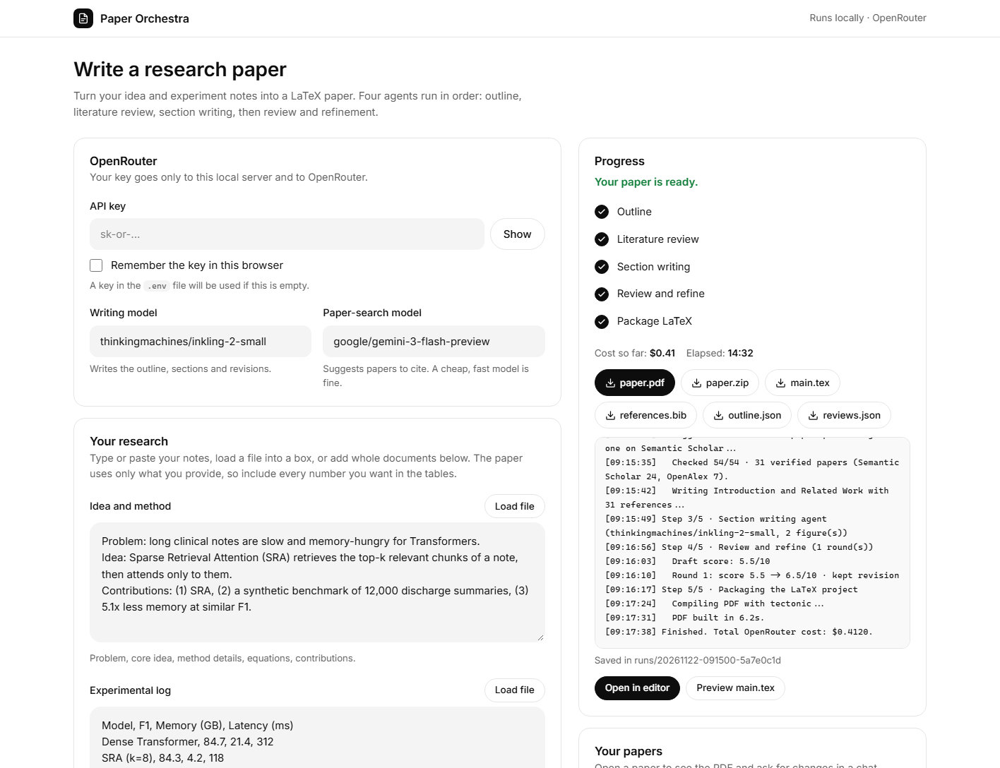

<div align="center">

# PaperScriptor

**Turn your notes and results into a LaTeX paper, then refine it by chatting with AI, all on your own machine.**

Built on Google Research's [PaperOrchestra](https://github.com/google-research/paper-orchestra) · Any model via [OpenRouter](https://openrouter.ai) · Web app + CLI · Apache-2.0

⭐ **If PaperScriptor helps you, please star the repo and [cite it](#citation).** ⭐

</div>



## Why PaperScriptor

| | |
|---|---|
| ✍️ **Writes the whole paper** | Outline → literature review → sections → AI review and revision, in your venue's LaTeX template. |
| 🔎 **Real references only** | Every citation is checked on Semantic Scholar / OpenAlex. Papers that don't exist never reach your `.bib`. |
| 💬 **Edit by chatting** | "Shorten the abstract", "address reviewer 2", "add citations here": it edits several files at once and shows the diff. |
| 📄 **A full LaTeX editor** | File tree, code editor, live PDF, double-click the PDF to jump to the source, versions and undo. |
| 🔒 **Local and cheap** | Runs on `127.0.0.1`. A full paper costs about **$1**; a chat edit costs a fraction of a cent. |


<sub>Screenshots use a made-up demo paper.</sub>

## Quick start

Requires **Python 3.10+** and an **[OpenRouter key](https://openrouter.ai/settings/keys)**.

**Windows:** double-click **`run.bat`**. It installs everything, including a free LaTeX engine for PDFs, and opens
<http://127.0.0.1:8000>.

**Any OS:**

```bash
python -m venv .venv && source .venv/bin/activate   # Windows: .venv\Scripts\activate
pip install -e .
paperscriptor setup-latex    # Windows; on macOS/Linux install TeX Live or Tectonic instead
paperscriptor                # starts the web app
```

Paste your key into the page, or put it in `.env` (copy `.env.example`).

## Features

**Write**

- Input as text or documents: Markdown, PDF, Word, CSV, JSON, LaTeX. Figures with captions.
- Templates: ICLR 2025, CVPR 2025, Nature (Springer Nature), or **your own journal kit** (.zip / folder).
- Tables use only your numbers. A revision is kept only if the AI reviewer's score doesn't drop.

**Edit** (any LaTeX project, including Overleaf downloads)

- See every file; choose which `.tex` to compile (main paper or supplementary).
- Multi-file AI edits with diffs, **verified citations**, file attachments ("address these reviews").
- CodeMirror editor, PDF.js preview that keeps your place, PDF ↔ source jumps (SyncTeX).
- Compiles past errors like Overleaf, with clickable error lines. Missing figures become placeholders.
- Every version of the whole project is saved. Export a `.zip` for Overleaf any time.

## Command line

```bash
paperscriptor write --idea notes.md --log results.csv --template nature
paperscriptor import my-overleaf-project.zip
paperscriptor ask last "Shorten the abstract to 150 words" --diff
paperscriptor ask last "Add citations for efficient attention" --file sections/intro.tex
paperscriptor ask last "Address these comments" --attach reviews.pdf
paperscriptor compile last --main supplementary.tex
paperscriptor undo last
paperscriptor export last -o paper.zip
```

`paperscriptor --help` lists everything. Without installing, use `python -m paperscriptor ...`.

## How it works

1. **Outline agent:** plans sections, figures and literature searches.
2. **Literature agent:** suggests papers, verifies each one, builds `references.bib`, writes the Intro and Related Work.
3. **Section agent:** writes method, experiments and tables from your results.
4. **Review and refine:** an AI reviewer scores the draft; the writer revises; worse revisions are discarded.
5. **Package:** strips unknown citations, compiles the PDF, zips the project.

In the editor, the model replies with small search-and-replace edits per file. PaperScriptor applies them, rejects
changes that would break the document, removes invented citation keys, saves a version and recompiles.

## Cost

| | `inkling-2-small` (default) | `gemini-3.1-pro` |
|---|---|---|
| Full paper | ~$0.70–1.00 | ~$1.50–3.00 |
| Chat edit | ~$0.0005 | ~$0.01 |

Web search adds about $0.50 per paper (optional). Reference checks are free.

## Privacy

Everything is stored in `runs/` on your machine. Your text is sent only to OpenRouter (and the model you pick).
Paper titles are sent to Semantic Scholar and OpenAlex for verification.

<details>
<summary><b>Configuration</b></summary>

Set in `.env`:

| Variable | Purpose |
|---|---|
| `OPENROUTER_API_KEY` | Your OpenRouter key |
| `SEMANTIC_SCHOLAR_API_KEY` | Faster reference checks ([get one](https://www.semanticscholar.org/product/api)) |
| `OPENALEX_API_KEY` | Higher limit for the backup database ([get one](https://openalex.org/settings/api)) |
| `PORT` | Web app port (default 8000) |
| `PAPERSCRIPTOR_HOME` | Where `runs/`, `tools/` and `.env` live (default: the repo folder) |

</details>

<details>
<summary><b>Project structure</b></summary>

```text
paperscriptor/
├── server.py          web app (FastAPI)
├── cli.py             command line
├── pipeline.py        paper-writing agents
├── llm.py             OpenRouter client (streaming)
├── references.py      Semantic Scholar / OpenAlex checks, BibTeX
├── prompts.py         PaperOrchestra prompts
├── workspace/         editor: project.py · chat.py · build.py
├── latex.py           compiling, error parsing, LaTeX setup
├── synctex.py         PDF ↔ source jumps
├── ingest.py          PDF / Word / zip import
├── config.py          paths and settings
├── static/            index.html · css/app.css · js/app.js
└── templates/         iclr2025 · cvpr2025 · nature
tests/                 offline tests (fake model, fake LaTeX)
```

Run the tests: `pip install -e ".[dev]"`, then `python tests/run_all.py`.

</details>

## Citation

If PaperScriptor helps your work, please cite it, and star ⭐ the repo so others can find it.

```bibtex
@software{khairnar2026paperscriptor,
  author  = {Khairnar, Shekhar Madhav},
  title   = {PaperScriptor: a local web app and CLI for writing and editing LaTeX research papers with LLMs},
  year    = {2026},
  version = {1.0.0}
}
```

Please also cite **PaperOrchestra**, which this project builds on:

```bibtex
@article{song2026paperorchestra,
  title   = {PaperOrchestra: A Multi-Agent Framework for Automated AI Research Paper Writing},
  author  = {Song, Yiwen and Song, Yale and Pfister, Tomas and Yoon, Jinsung},
  journal = {arXiv preprint arXiv:2604.05018},
  year    = {2026}
}
```

## License

[Apache-2.0](LICENSE). See [NOTICE](NOTICE) for third-party parts:

- Prompts, ICLR/CVPR templates and pipeline design come from
  [google-research/paper-orchestra](https://github.com/google-research/paper-orchestra) (Apache-2.0). This project is
  not affiliated with Google.
- The Springer Nature class files are under LPPL 1.3c.

> **Note:** AI makes mistakes. Check every number and claim, and follow your venue's policy on AI-assisted writing.
